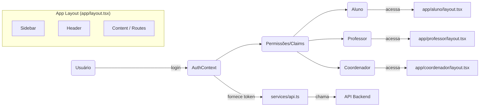

**Projeto Estágio — Sistema de Gestão de Estágios**

Este repositório contém uma aplicação Next.js (TypeScript) para gestão de estágios com arquitetura baseada em papéis (RBAC). Este README documenta o escopo completo do projeto, a arquitetura RBAC, como as rotas e pastas estão organizadas, bibliotecas utilizadas, componentes principais, padrão de chamadas à API, e detalhes sobre hooks, contexts, services e types.

**Visão Geral**:

- **Resumo:** Aplicação para gerenciar vagas, estagiários, relatórios e comunicação entre `aluno`, `professor` e `coordenador`.
- **Tecnologia principal:** Next.js (App Router), React, TypeScript, Tailwind CSS.

**Estrutura do Repositório**

- **`app/`**: Rotas da aplicação usando o App Router do Next.js. Cada pasta dentro de `app` representa uma rota ou grupo de rotas (ex.: `aluno`, `professor`, `coordenador`, `(auth)`).
- **`src/`**: Componentes reutilizáveis, contexts, hooks e services — código compartilhado pela UI.
- **`components/`**: Componentes específicos da aplicação (ex.: `common`, `ui`).
- **`public/`**: Arquivos públicos (assets, imagens).
- **`api/`**: Endpoints API (se houver implementações serverless locais).
- **`lib/`**: Utilitários genéricos (ex.: `utils.ts`).
- **`contexts/`, `hooks/`, `services/`, `types/`** (dentro de `src/`): padrões para estado, chamadas de API, tipagens e hooks.

**Arquitetura RBAC (Role-Based Access Control)**

- **Papéis principais:** `aluno`, `professor`, `coordenador` (definidos em `src/types/roles.ts`).
- **Fonte da verdade:** Tipos e permissões estão centralizados em `types/roles.ts` e em hooks/contexts que interpretam esses papéis.
- **Enforcement (como é aplicado):**
  - `AuthContext` fornece usuário e lista de roles/permissions;
  - `ProtectedRoute` e `RoleBasedContent` controlam acesso a rotas e UI com base nas roles;
  - Componentes de nível de rota (por exemplo, `app/aluno/*`) são protegidos pelo layout que verifica o contexto de autenticação.
- **Fluxo típico:** Usuário faz login → `AuthContext` armazena token/usuário → `usePermissions()` deriva permissões → componentes autorizam/negam renderização ou redirecionam.

**Como as rotas funcionam e criação de pastas**

- Este projeto usa o App Router do Next.js (pasta `app/`). Cada pasta corresponde a uma rota:
  - `app/aluno/page.tsx` → `/aluno`
  - `app/aluno/inicio/page.tsx` → `/aluno/inicio`
  - `app/(auth)/login/page.tsx` → rota de login (agrupamento de rota com parênteses para layouts compartilhados)
- Padrões:
  - Pastas com `page.tsx` ou `layout.tsx` definem páginas e layouts;
  - Subpastas representam rotas aninhadas;
  - Componentes específicos de rota ficam dentro das mesmas pastas (`components/`) para manter coesão.

**Bibliotecas Principais Utilizadas**

- `next` — App Router, SSR/SSG e funcionalidades Next.js.
- `react` — UI.
- `typescript` — tipagem estática.
- `tailwindcss` — estilização utilitária.
- `postcss` — processamento CSS.
- `axios` — cliente HTTP para chamadas à API.
- `eslint` — linting e consistência de código.

**Principais Componentes Reutilizados**

- `Sidebar` (duplicado entre `src/components/Header/SideBar.tsx` e `src/components/layout/Sidebar.tsx`): navegação persistente.
- `Header` / `ContentHeader`: cabeçalhos e ações globais.
- `Layout` / `LayoutContent`: layout wrapper usado por páginas que precisam do mesmo frame (sidebar + header + conteúdo).
- `ProtectedRoute`: componente que envolve rotas que exigem autenticação.
- `RoleBasedContent` (`src/components/common/RoleBasedContent.tsx`): renderiza UI condicional por papel.
- `DevToolsIndicator`: indicador de ambiente/desenvolvimento.

**Como é feita a chamada da API**

- Padrão: centralizar a configuração do cliente HTTP em `src/services/api.ts` (por exemplo, `axios.create({ baseURL })`).
- Autenticação: `AuthContext` disponibiliza token; `api` adiciona header `Authorization: Bearer <token>` via interceptors ou por função utilitária.
- Exemplos de uso (conceitual):

`// src/services/internshipService.ts - exemplo`

`import api from './api'`

`export const getInternships = () => api.get('/internships')`

- Recomendações: tratar erros em um nível de serviço, devolver dados já mapeados para o frontend, e centralizar refresh de token/interceptors quando necessário.

**Sidebar (presente em todo o layout)**

- Localização: `src/components/layout/Sidebar.tsx` e `src/components/Header/SideBar.tsx`.
- Propósito: navegação global entre seções (aluno, professor, coordenador, mensagens, vagas, etc.).
- Como funciona:
  - Renderizada dentro do `Layout` de nível superior (e.g., `app/layout.tsx` ou `src/components/Layout.tsx`), garantindo presença em todas as páginas que usam esse layout;
  - Pode usar `usePermissions()` ou `AuthContext` para mostrar/ocultar itens conforme permissões do usuário;
  - Responsividade: normalmente colapsa em telas pequenas e vira um menu hamburguer controlado pelo `Header`.

**Hooks, Contexts, Services e Types**

- `hooks/` (src/hooks):
  - `usePermissions.ts`: deriva e expõe permissões a partir das roles do usuário;
  - `useInternships.ts`: encapsula lógica de fetch/pagination/estado local para estágios;
  - `roleDisplayName.ts`: utilitário para mapear `roleKey` → nome legível;
  - `useDevShortcuts.ts`: atalhos e helpers para desenvolvimento.
- `contexts/AuthContext.tsx`:
  - Fornece: `user`, `token`, `login()`, `logout()`, `refresh()`;
  - Mantém estado de autenticação e expõe um wrapper para chamadas autenticadas.
- `services/`:
  - `api.ts`: cliente HTTP com baseURL e interceptors;
  - `auth.ts`: chamadas de login/logout e gerenciamento de tokens;
  - `internshipService.ts`: operações CRUD relacionadas a estágios.
- `types/`:
  - Tipos e interfaces (ex.: `User`, `Internship`, `Role`) — mantém contratos claros entre frontend e backend.

**Layout e Role-Based**

- Layouts estão implementados em níveis: raiz (`app/layout.tsx`), áreas por papel (`app/aluno/layout.tsx`, `app/professor/layout.tsx`, etc.).
- Cada layout injeta componentes globais (Sidebar, Header) e aplica checagens de autorização via `ProtectedRoute` ou guardas no `layout.tsx`.

**`components/common` — explicação dos componentes**

- `SearchComponent.tsx` (components/common): componente de pesquisa reutilizável com debounce, sugestões e acessibilidade;
- `RoleBasedContent.tsx` (src/components/common): componente auxiliar para renderizar partes da UI apenas para roles específicas;
- `ui/table.tsx` (components/ui): tabela estilizada com suporte a paginação/colunas configuráveis — usado em múltiplas vistas de listagem.

**`src/components` — explicação de cada componente**

- `DevToolsIndicator.tsx`: exibe estado de dev (hotkeys, modo dev) — aparece globalmente em layouts de dev;
- `LayoutContent.tsx`: wrapper que fornece espaçamento e grid para o conteúdo principal da página;
- `ProtectedRoute.tsx`: redireciona usuários não autenticados para a rota de login e mostra placeholders enquanto valida o token;
- `common/RoleBasedContent.tsx`: já descrito; módulo central para condicional por role;
- `Header/ContentHeader.tsx`: cabeçalho local de seção com título, breadcrumbs e ações (botões de criação, filtros);
- `Header/SideBar.tsx`: implementação do componente visual da sidebar usado pelo Header;
- `layout/Header.tsx`: header global com avatar, logout, e controle de sidebar;
- `layout/Layout.tsx`: layout padrão que compõe `Header`, `Sidebar` e `LayoutContent` para páginas internas;
- `layout/Sidebar.tsx`: árvore de navegação e links principais da aplicação;
- `role-based/` (subpastas): componentes e cards específicos por papel, por exemplo `coordenador/` e `professor/` possuem cards e modais específicos como `AprovarEstagioModal.tsx`, `OrientadosCard.tsx`.

**Componentes dentro de `app/*` e `aluno/*`, `coordenador/*` e `professor/*`**

- Muitas páginas incluem componentes locais que lidam com funcionalidades específicas, por exemplo:
  - `aluno/meus-estagios` contém modais para `ConcluirEstagio`, `RegistrarRelatorio`, e pages para criar/atualizar estágios;
  - `coordenador/estagios` contém cartões de confirmação e modais de aprovação/rejeição;
  - `mensagens` costuma ter cards de listagem de conversas e visualização.
- Padrão: manter componentes relacionados à página dentro da mesma pasta facilita entendimento e reload incremental do Next.

**Boas práticas e recomendações (para o portfólio)**

- Mostrar trechos de `AuthContext` e `api.ts` com exemplos de chamadas e interceptors;
- Destaque responsabilidades: UI (components/), estado/global (contexts/), lógica de fetch (services/), tipos (types/);
- Documente decisões arquiteturais (por que App Router, por que RBAC centralizado) e trade-offs.

**Execução local (resumo rápido)**

- Instalar dependências:

```bash
npm install
```

- Rodar em desenvolvimento:

```bash
npm run dev
```

- Build:

```bash
npm run build
npm run start
```

**Próximos passos sugeridos**

- Incluir exemplos de payloads de API e resposta no README (endpoints principais);
- Adicionar diagrama RBAC (Mermaid) destacando fluxos de autorização;
- Criar guia rápido para contribuir e para executar testes/lint no repositório.

**Diagrama RBAC e Hierarquia de Layouts**



---

- Adicionar exemplos de código do `AuthContext` e de `src/services/api.ts` ao README.
- Gerar um diagrama Mermaid mostrando a hierarquia de layouts e fluxo RBAC.

O arquivo README atualizado está salvo em [README.md](README.md).
This is a [Next.js](https://nextjs.org) project bootstrapped with [`create-next-app`](https://nextjs.org/docs/app/api-reference/cli/create-next-app).

## Getting Started

First, run the development server:

```bash
npm run dev
# or
yarn dev
# or
pnpm dev
# or
bun dev
```

Open [http://localhost:3000](http://localhost:3000) with your browser to see the result.

You can start editing the page by modifying `app/page.tsx`. The page auto-updates as you edit the file.

This project uses [`next/font`](https://nextjs.org/docs/app/building-your-application/optimizing/fonts) to automatically optimize and load [Geist](https://vercel.com/font), a new font family for Vercel.

## Learn More

To learn more about Next.js, take a look at the following resources:

- [Next.js Documentation](https://nextjs.org/docs) - learn about Next.js features and API.
- [Learn Next.js](https://nextjs.org/learn) - an interactive Next.js tutorial.

You can check out [the Next.js GitHub repository](https://github.com/vercel/next.js) - your feedback and contributions are welcome!

## Deploy on Vercel

The easiest way to deploy your Next.js app is to use the [Vercel Platform](https://vercel.com/new?utm_medium=default-template&filter=next.js&utm_source=create-next-app&utm_campaign=create-next-app-readme) from the creators of Next.js.

Check out our [Next.js deployment documentation](https://nextjs.org/docs/app/building-your-application/deploying) for more details.
